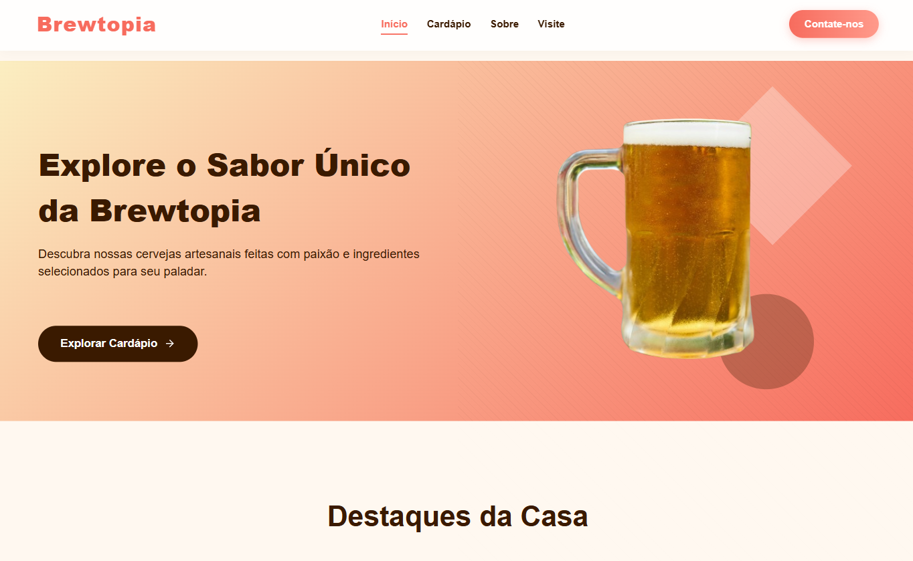
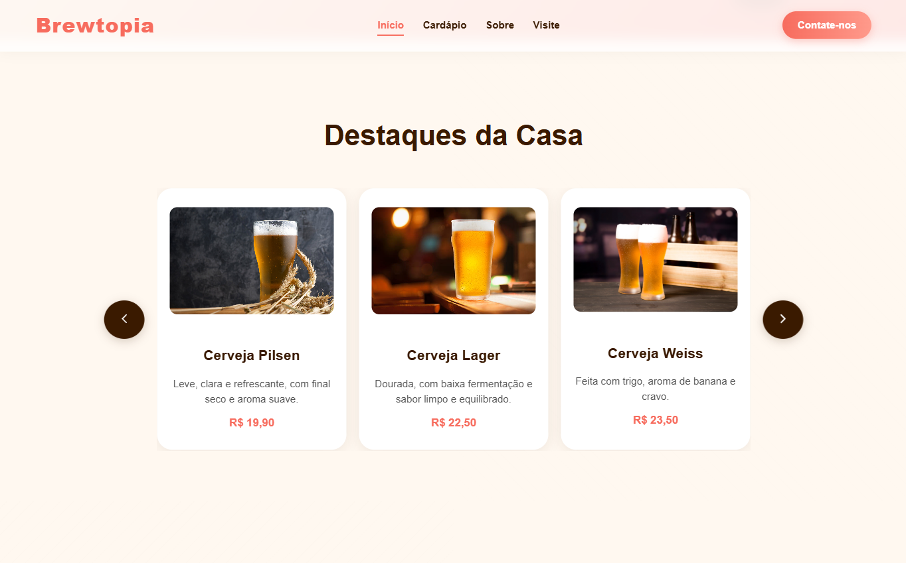
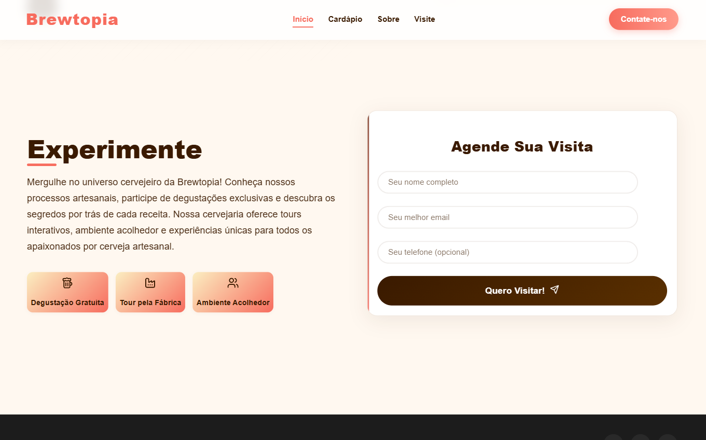
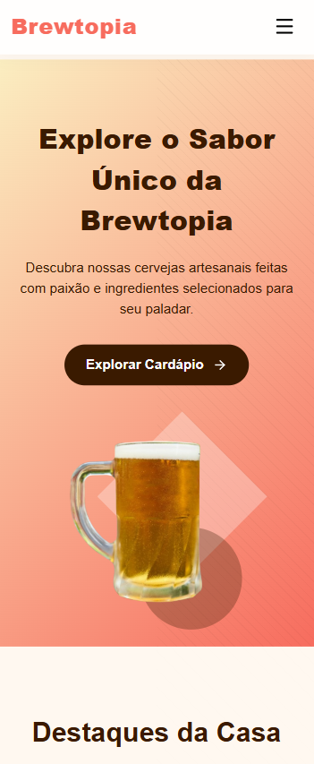

<div align="center">

# 🍺 Brewtopia — Craft Brewery Landing Page

**A landing page for a fictional craft brewery, built to showcase its beers and make contact easy.**


[🌐 Live site](https://brewtopia-cervejaria.vercel.app/)

</div>



## ⚡ At a glance

- **Concept project:** Brewtopia is a fictional brand, created to practice building a complete landing page.
- **Goal:** present a product line and give visitors a direct way to get in touch.
- **My role:** UI design and front-end development.

## ✨ Features

| Feature | What it does |
|---|---|
| 🍻 **Product carousel** | Lets visitors browse the brewery's main beers |
| ✉️ **Contact form** | Gives visitors a way to get in touch with the brewery |

## 📸 Screens

| Product carousel | Contact form |
|---|---|
|  |  |

| Mobile |
|---|
|  |


## 🏗️ Technical notes

- **Next.js** with **React** components for fast loading and good SEO.
- **Plain CSS** for styling, with no UI library.

## 🛠️ Run locally

```bash
git clone https://github.com/larissabenvenuti/Brewtopia.git
cd Brewtopia
npm install
npm run dev
```

Open http://localhost:3000.

## 🔒 Copyright & license

**All rights reserved.**

The source code, design and all other elements in this repository belong exclusively to **Larissa Benvenuti**. Brewtopia is a fictional brand.

Reproduction, distribution, modification, public display or commercial use, in whole or in part, without the written permission of the rights holder is strictly prohibited.